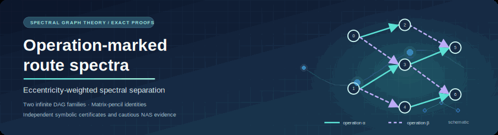
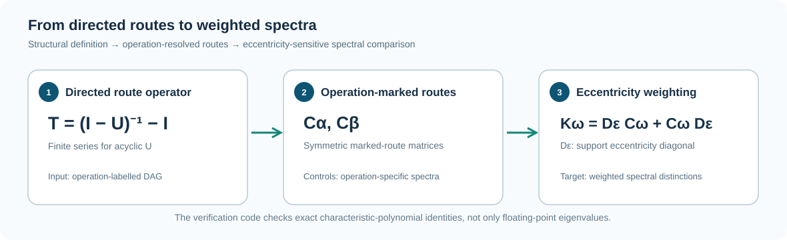
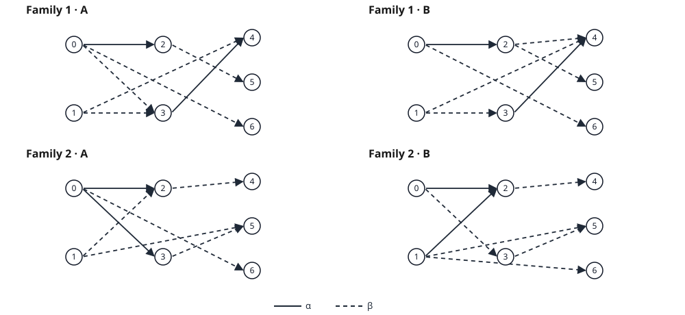
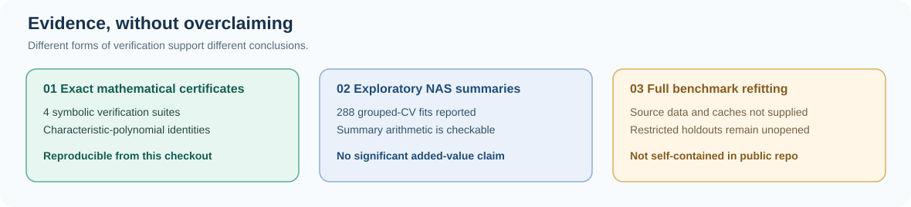

<p align="center">
  
</p>

<h1 align="center">Operation-Marked Eccentricity-Weighted Route Spectra</h1>

<p align="center">
  <strong>Mathematical constructions, exact spectral certificates, and reproducibility materials<br/>
  for operation-labelled feedforward architecture graphs.</strong>
</p>

<p align="center">
  <a href="https://github.com/SunilgarGusai/operation-marked-route-spectra/actions/workflows/repository-validation.yml"></a>
  <a href="LICENSE"></a>
  <a href="requirements-proofs.txt"></a>
  <a href="QUICKSTART.md"></a>
  <a href="docs/FROZEN_RESULTS.md"></a>
</p>

<p align="center">
<a href="#the-research-question">Research question</a> ·
<a href="#the-key-mathematical-distinction">Mathematical result</a> ·
<a href="#reproduce-the-results">Reproduce</a> ·
<a href="#empirical-context">Benchmarks</a> ·
<a href="#reviewer-navigation">Reviewer navigation</a> ·
<a href="#citation-and-provenance">Citation</a>
</p>

---

## The research question

**Can operation-labelled feedforward architectures share the ordinary route spectra and eccentricity-weighted adjacency-control spectra, yet be distinguished by eccentricity-weighted *route* spectra?**

The associated mathematics-first manuscript answers this question affirmatively through **two explicit infinite families of seven-vertex seed DAGs**. The stronger family remains cospectral for a full ordinary operation-route matrix pencil, while the new weighted route operator separates the families exactly. This repository packages the mathematical checks and cautiously interpreted neural-architecture experiments.

> **Evidence distinction.** The symbolic identities are reproducible from this checkout; the 288 NAS-Bench fits are reported exploratory development results whose full refitting needs external data and saved historical preprocessing caches. **No reliable predictive superiority is claimed.**

## The key mathematical distinction



For a directed acyclic route-count matrix `U`, the finite path operator is `T = (I − U)⁻¹ − I`. Operation-marked symmetric route matrices `Cα` and `Cβ` are compared with their eccentricity-weighted counterparts `Kω = Dε Cω + Cω Dε`, where `Dε` is the support-graph eccentricity diagonal.

The first seed family preserves the **entire characteristic polynomial** of the ordinary route pencil for real operation coefficients `t` and separates the weighted matrices for `t ≥ 0`. The exact second-moment difference is

$$
\Delta(s,t)=30s^3\big[s+2t(s+1)+t^2(s+2)\big]>0
\quad(s\ge1,\ t\ge0).
$$

The second seed family is structurally different and establishes noncospectrality for each marked operation separately; **it does not share the first family’s full joint-pencil identity**.



*Solid arcs denote operation α; dashed arcs denote β. The exact graph data are available in [`figures/seed_arc_lists.json`](figures/seed_arc_lists.json). The diagrams are provided for visual inspection; the proof scripts use the frozen arc lists directly.*

Read the [theorem-to-code map](docs/THEOREM_MAP.md) for the precise supported statements, proof entry points and scope limitations.

## Reproduce the results

<details open>
<summary><strong>Exact mathematical verification — four suites</strong></summary>

```bash
python -m pip install -r requirements-proofs.txt
python run_proofs.py
```

This regenerates the exact symbolic checks and is independent of NAS datasets and GPUs. [Full quick start →](QUICKSTART.md)

</details>

<details>
<summary><strong>Reported numerical summary checks — not a model refit</strong></summary>

```bash
python tests/check_reported_statistics.py
python scripts/validate_public_artifact.py
```

The commands validate reported table arithmetic and repository integrity. They do not reproduce training-label extraction or the 288 benchmark model fits. [Reproducibility boundary →](docs/BENCHMARK_REPRODUCIBILITY.md)

</details>



## Empirical context

Architecture prediction was assessed exploratorily on NAS-Bench-101 and NAS-Bench-201 using topology-aware grouped cross-validation and source-aligned graph features. The comparison does **not** establish statistically reliable independent gain over a strong structural baseline.

| Benchmark | GRAF + structural controls | + Weighted routes | Equal-topology improvement (95% exploratory interval) |
| :--- | ---: | ---: | :--- |
| NAS-Bench-101 | 1.2272 pp | 1.2232 pp | +0.00215 pp (−0.02359, +0.02669) |
| NAS-Bench-201 | 0.8842 pp | 0.8692 pp | +0.00656 pp (−0.00634, +0.01952) |

*MAE is in **validation-accuracy percentage points**; smaller is better. Both intervals cross zero. The full historical 288-model refit is not independently runnable from the public repository.* [Frozen results →](docs/FROZEN_RESULTS.md)

## Reviewer navigation

| Reviewer question | Go directly to |
| :--- | :--- |
| What is proved, precisely? | [Theorem and evidence map](docs/THEOREM_MAP.md) |
| How do I verify exact identities? | [Quick start](QUICKSTART.md) · [Verification scripts](verification/) |
| What are the actual graph constructions? | [Frozen seed arc lists](figures/seed_arc_lists.json) · [Witness diagram](docs/assets/witness-pairs.svg) |
| How are operation-marked routes defined? | [Method protocol](docs/METHOD_PROTOCOL.md) |
| What numerical results are supported? | [Frozen results](docs/FROZEN_RESULTS.md) |
| What is *not* established? | [Claim boundaries](docs/CLAIM_BOUNDARIES.md) |
| What was the exploratory experiment? | [Benchmark reproduction scope](docs/BENCHMARK_REPRODUCIBILITY.md) |
| What data can be redistributed? | [Data provenance](docs/DATA_PROVENANCE.md) |
| What code is adapted and under which terms? | [Attribution and licensing](docs/ATTRIBUTION_AND_LICENSE.md) |
| What role did AI tools play? | [AI methods summary](docs/AI_METHODS_SUMMARY.md) |

## Citation and provenance

This public repository accompanies the manuscript **“Operation-Marked Eccentricity-Weighted Route Spectra of Feedforward Architecture Graphs”**, by **Sunilgar L. Gusai** (corresponding author) and **Manoharsinh R. Jadeja**. It does not claim the paper has been accepted or published. Machine-readable citation metadata: [`CITATION.cff`](CITATION.cff).

Original project code is released under [MIT](LICENSE). The source-aligned GRAF baseline credits [Kadlecová et al. (ICML 2024)](https://github.com/gabikadlecova/GRAF) and retains its [upstream MIT notice](docs/GRAF_UPSTREAM_MIT_LICENSE.txt). Third-party benchmark data and unused reserved holdout outcomes are not distributed. [Licensing scope →](docs/LICENSING_STATUS.md)

Substantive OpenAI assistance in mathematical exploration, symbolic verification, experimental software and drafting is disclosed in [`docs/AI_METHODS_SUMMARY.md`](docs/AI_METHODS_SUMMARY.md). Its record is not misrepresented as a complete historical prompt archive.

---

<p align="center"><sub>Mathematics-first research · Exact certificates · Transparent benchmark limitations · Last reviewed October 2026</sub></p>
