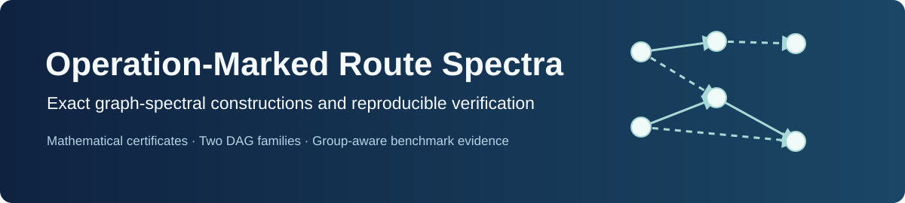

<p align="center"></p>

<h1 align="center">Operation-Marked Eccentricity-Weighted Route Spectra</h1>

<p align="center"><strong>Public reproducibility companion for<br/>Operation-Marked Eccentricity-Weighted Route Spectra of Feedforward Architecture Graphs</strong></p>

<p align="center">
  <a href="https://github.com/SunilgarGusai/operation-marked-route-spectra/actions/workflows/repository-validation.yml"></a>
  <a href="LICENSE"></a>
  <a href="CITATION.cff"></a>
  <a href="QUICKSTART.md"></a>
  
</p>

## Research question

When two operation-labelled directed acyclic architectures are spectrally indistinguishable under ordinary marked-route and eccentricity-weighted adjacency controls, can eccentricity-weighted **route** matrices separate them?

The associated mathematics-first manuscript constructs two infinite families of marked feedforward graphs. The stronger family preserves an entire ordinary-route **matrix pencil** while its weighted-route spectra separate, and the work derives an exact balance condition for a seven-vertex weighted edge-transfer template. Distinct examples and polynomial identities are checked using exact arithmetic, not approximate eigensolvers.

<p align="center"></p>

## At a glance

- **Two seven-vertex seed pairs**, specified unambiguously in [`figures/seed_arc_lists.json`](figures/seed_arc_lists.json).
- **Four exact verification suites**, standalone and independent of benchmark data, in [`verification/`](verification/).
- **Operation-marked pencil** and balanced edge-transfer certificates in [`results/`](results/).
- **288 exploratory grouped-CV model fits** across NAS-Bench-101 and NAS-Bench-201 recorded as numerical summaries, *not* reconstructed in full from this public checkout.
- **Reserved holdout labels remained unused** according to the frozen experiment records.

## Reproducibility levels

| Layer | Public materials | What it establishes |
| :--- | :--- | :--- |
| A. Mathematics | Four SymPy verifiers, graph definitions, exact certificates | Recomputes the paper's key symbolic identities |
| B. Reported numerical summaries | Frozen CSVs and arithmetic checker | Confirms table and contrast consistency; **not** a model refit |
| C. Full ML refitting | Historical implementation scripts, source fingerprints and protocol | **Not yet self-contained**; externally licensed datasets and frozen local feature caches/checkpoints are missing |

Run the exact tests with **no GPU and no NAS datasets**:

```bash
python -m pip install -r requirements-proofs.txt
python run_proofs.py
python tests/check_reported_statistics.py
python scripts/validate_public_artifact.py
```

See [Quick start](QUICKSTART.md) for environment instructions, [method protocol](docs/METHOD_PROTOCOL.md) and [claim boundaries](docs/CLAIM_BOUNDARIES.md) for correct interpretation.

## Scientific results

The mathematics establishes exact all-width noncospectrality for two distinct infinite architecture families. The model-prediction exercises are exploratory: adding weighted route features yields small mean errors reductions under grouped cross-validation, while topology-level uncertainty intervals include zero. **No statistically reliable superiority over strong structural baselines is claimed.** [Frozen numerical results](docs/FROZEN_RESULTS.md) gives the corresponding numbers and units.

## Reviewer map

| Question | Where to look |
| :--- | :--- |
| Verify all key mathematical identities | `python run_proofs.py` and `verification/` |
| Inspect the two labelled graph families | `figures/seed_arc_lists.json` |
| Locate exact polynomial certificates | `results/` |
| Understand experimental design and access | `docs/METHOD_PROTOCOL.md`, `docs/BENCHMARK_REPRODUCIBILITY.md` |
| Check experimental summary arithmetic | `tests/check_reported_statistics.py` |
| Locate numerical claims, confidence intervals | `docs/FROZEN_RESULTS.md` |
| Understand what is *not* claimed | `docs/CLAIM_BOUNDARIES.md` |
| Verify input fingerprints | `docs/SOURCE_SHA256.json` |
| Inspect data rights and prior-code attribution | `docs/LICENSING_STATUS.md`, `docs/GRAF_UPSTREAM_MIT_LICENSE.txt` |

## Attribution and provenance

The operation-restricted graph features adapt methods/code from [Kadlecová et al., GRAF (ICML 2024)](https://github.com/gabikadlecova/GRAF), which is MIT licensed (upstream notice included). NAS-Bench-101 and NAS-Bench-201 are independent benchmark datasets not redistributed here. Earlier VELE, generic spectral switching and uniform graph replication are acknowledged as established prior methods.

Substantive AI assistance in mathematical exploration, symbolic code, experiment software and drafting is documented in [`docs/AI_METHODS_SUMMARY.md`](docs/AI_METHODS_SUMMARY.md). Both human authors retain responsibility for the manuscript's validity and originality.

**Licensing:** original code and documentation are now released under the [MIT License](LICENSE) on the corresponding author’s authorization. GRAF-origin code retains the upstream [MIT notice](docs/GRAF_UPSTREAM_MIT_LICENSE.txt). External benchmark data are not redistributed; see [`docs/LICENSING_STATUS.md`](docs/LICENSING_STATUS.md).

## Authors and citation

Sunilgar L. Gusai (corresponding author) and Manoharsinh R. Jadeja. Use [`CITATION.cff`](CITATION.cff) for machine-readable citation metadata; manuscript submission and acceptance are not claimed.
